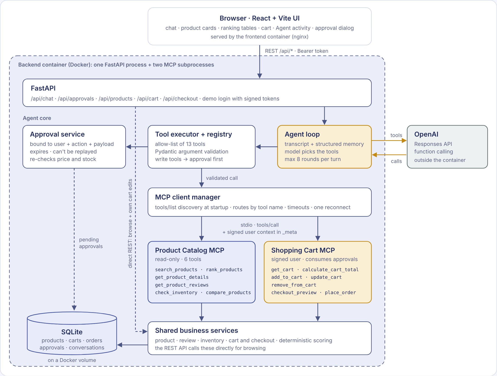
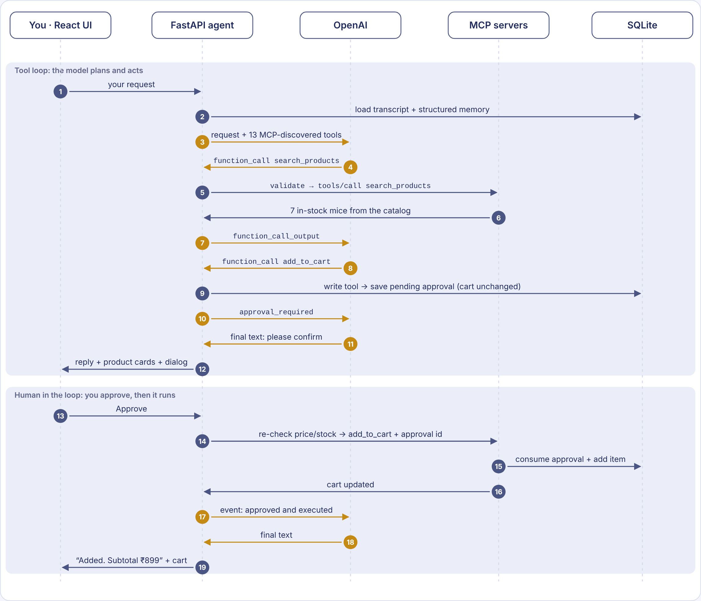
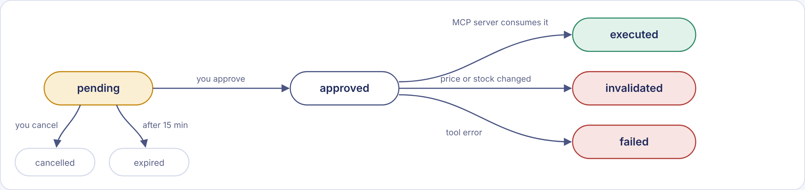
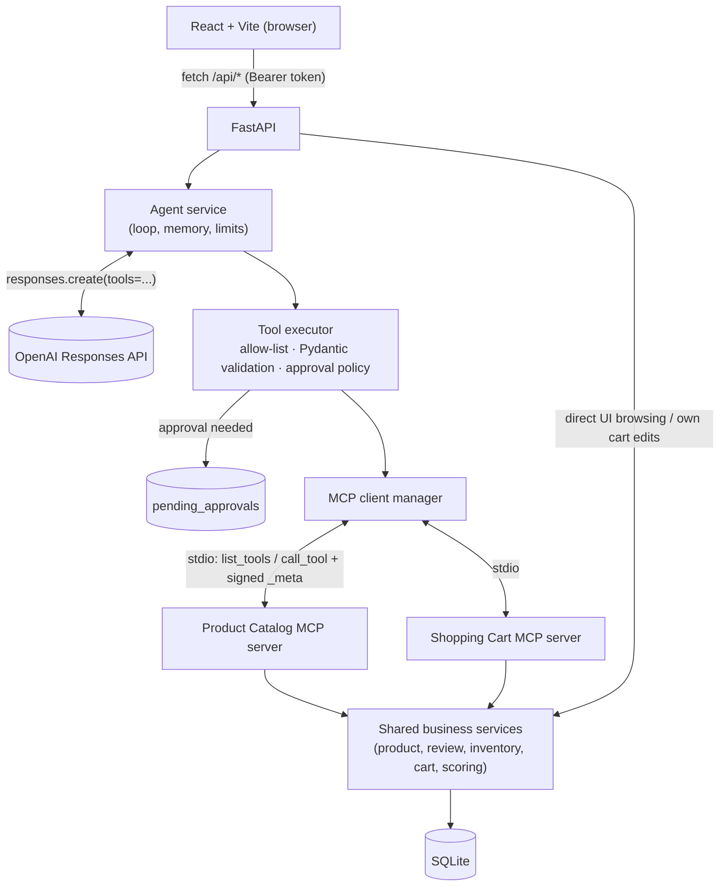
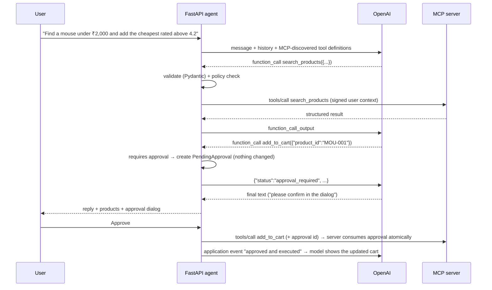

# AI E-Commerce Agent — OpenAI tool calling + MCP + agentic workflows

A learning project: a shopping assistant ("ShopMate") that understands natural-language requests and **decides for
itself which tools to call** — catalog search, deterministic product ranking, inventory checks, cart changes,
simulated checkout — through **two real Model Context Protocol (MCP) servers**. State-changing actions always wait
for **your explicit approval**, enforced by backend code rather than by the prompt.

> All products, prices, ratings, reviews and stock levels are **demonstration data** (INR). They are not live
> retailer listings. Orders are **simulated**: no payment is taken and no retailer receives them.

---

## 1. Features

- **Real OpenAI tool calling** with the official Python SDK and the **Responses API** (`client.responses.create`).
  No keyword routing: the model chooses tools from their descriptions and the conversation.
- **Two real MCP servers** built with the official MCP Python SDK (`MCPServer`, stdio transport):
  - *Product Catalog*: `search_products`, `get_product_details`, `check_inventory`, `get_product_reviews`,
    `compare_products`, `rank_products`
  - *Shopping Cart*: `get_cart`, `add_to_cart`, `update_cart`, `remove_from_cart`, `calculate_cart_total`,
    `checkout_preview`, `place_order`
- **MCP client in FastAPI** that launches both servers, **discovers their tools at runtime**, converts them to
  OpenAI function tools, routes calls to the right server and handles timeouts and disconnections.
- **Deterministic scoring algorithm** (performance 40 / price value 25 / rating 20 / battery 15 for laptops),
  hard constraints, Bayesian rating confidence and honest machine-learning suitability notes.
- **Human-in-the-loop approvals**: cart and order changes create a pending approval tied to *user + action +
  exact payload*. Approvals expire, can't be replayed, and are re-validated (price/stock) before execution. The cart
  MCP server itself refuses mutations without a matching approved request.
- **Conversation memory**: persistent transcript + structured state (last filters, ranked products, cart snapshot).
- **Demo authentication** with per-user carts and conversations; the user identity reaches MCP servers as a
  **signed** context, never as a model-chosen argument.
- **React + Vite UI** with chat, product cards, comparison/ranking tables, catalog browsing with filters, cart,
  confirmation dialog and an **Agent activity** panel that shows every tool call, its validated arguments, the MCP
  server that ran it and the real result.
- **81 automated tests** (no API key needed) including real stdio MCP integration tests; optional live OpenAI tests.

## 2. Architecture



**Workflow of one request** ("Find a wireless mouse under ₹2,000 and add the cheapest one rated above 4.2 to my cart"):



**Approval lifecycle** for every cart change and order:



The same structure as Mermaid diagrams (rendered by GitHub):



A single chat turn:



## 3. Technology stack

| Layer | Technology |
|---|---|
| Frontend | React 18, Vite 5, JavaScript, CSS, Fetch API, react-markdown |
| Backend | Python 3.11+ (tested on 3.13), FastAPI, Pydantic v2, SQLAlchemy 2, SQLite |
| AI | OpenAI Python SDK (`openai` 3.x), Responses API, function tools |
| MCP | Official `mcp` Python SDK 2.x — `MCPServer` (servers), `mcp.Client` + `StdioServerParameters` (client) |
| Tests | Pytest, FastAPI TestClient, httpx MockTransport |

## 4. Project structure

```
ai-ecommerce-agent/
├── backend/
│   ├── requirements.txt
│   ├── pytest.ini
│   └── app/
│       ├── main.py                 # FastAPI app + lifespan (starts/stops MCP servers)
│       ├── config.py               # settings from environment / .env
│       ├── api/                    # HTTP routes: chat.py, products.py, cart.py, deps.py
│       ├── agent/
│       │   ├── agent_service.py    # the agent loop (Responses API)
│       │   ├── openai_client.py    # SDK wrapper + error mapping
│       │   ├── mcp_client.py       # MCP connections, discovery, routing, OpenAI conversion
│       │   ├── tool_registry.py    # allow-list: risk, approval, auth policies
│       │   ├── tool_schemas.py     # Pydantic input models (single source of truth)
│       │   ├── tool_executor.py    # validate → policy → approval or MCP call; traces
│       │   ├── approval_service.py # human-in-the-loop lifecycle
│       │   ├── conversation_service.py  # transcript + structured memory
│       │   └── scoring_service.py  # deterministic ranking
│       ├── auth/                   # demo login, password hashing, signed tokens, MCP context
│       ├── database/               # engine, ORM models, API schemas, seed data
│       ├── services/               # business logic shared by API and MCP servers
│       └── tests/                  # pytest suite
├── mcp_servers/
│   ├── common/                     # sys.path bootstrap, shared tool runner
│   ├── product_catalog/            # server.py (MCP) + tools.py (adapters)
│   └── shopping_cart/              # server.py (MCP) + tools.py (adapters)
├── frontend/
│   ├── package.json, vite.config.js, index.html
│   └── src/  App.jsx, main.jsx, styles.css, services/api.js, services/format.js, components/*.jsx
├── docs/LEARNING_GUIDE.md
├── .env.example
├── start-backend.ps1, start-frontend.ps1
└── README.md
```

## 5. Prerequisites (Windows)

- **Python 3.11 or newer** — `python --version` (tick "Add python.exe to PATH" when installing).
- **Node.js 18+ and npm** — `node --version`, `npm --version`.
- An **OpenAI API key** for the chat agent (everything else — browsing, cart, tests — works without one).

## 6. Setup (Windows PowerShell)

All commands assume you start in the project folder, e.g. `C:\Users\<you>\Downloads\poc\RAG_\ai-ecommerce-agent`.

### 6.1 Environment variables

```powershell
Copy-Item .env.example .env
notepad .env
```

Set at least `OPENAI_API_KEY`, `OPENAI_MODEL` and a random `APP_SECRET_KEY`:

```powershell
python -c "import secrets; print(secrets.token_urlsafe(48))"
```

The frontend needs no secrets. Optionally `Copy-Item frontend\.env.example frontend\.env` to change the backend
URL. **Never put the OpenAI key in a `VITE_` variable** — those are shipped to the browser.

### 6.2 Backend (Python virtual environment)

```powershell
cd backend
python -m venv .venv
.\.venv\Scripts\Activate.ps1
python -m pip install --upgrade pip
pip install -r requirements.txt
```

If PowerShell blocks `Activate.ps1`, run once:
`Set-ExecutionPolicy -Scope CurrentUser -ExecutionPolicy RemoteSigned`.

### 6.3 Database and seed data

The database is created and seeded **automatically** the first time FastAPI starts. To (re)seed manually:

```powershell
# from backend\ with the venv active
python -m app.database.seed          # create tables + seed if missing
python -m app.database.seed --reset  # drop everything and start fresh (60 demo products, 3 demo users)
```

### 6.4 Frontend

```powershell
cd ..\frontend
npm install
```

## 7. Running the application

### 7.0 Option A — Docker (one command)

Requires Docker Desktop running. From the project folder (the one containing `docker-compose.yml`):

```powershell
Copy-Item .env.example .env     # first time only; set OPENAI_API_KEY, OPENAI_MODEL, APP_SECRET_KEY
docker compose up --build
```

Open **http://localhost:5173** (API docs: http://localhost:8000/docs). Stop with `Ctrl+C`, or run
`docker compose down`. The database lives in the `ecommerce-data` volume; `docker compose down -v` deletes it
for a fresh start. Both MCP servers run inside the backend container, launched by FastAPI exactly as in a local run.
Your `.env` is passed to the backend at runtime and is never copied into an image.

### 7.1 Option B — two terminals (no Docker)

You need **two terminals**.

**Terminal 1 — backend (also starts both MCP servers):**

```powershell
cd backend
.\.venv\Scripts\Activate.ps1
python -m uvicorn app.main:app --host 127.0.0.1 --port 8000
```

You should see:

```
MCP server product_catalog connected (product-catalog 1.0.0): 6 tools
MCP server shopping_cart connected (shopping-cart 1.0.0): 7 tools
```

**Terminal 2 — frontend:**

```powershell
cd frontend
npm run dev
```

Open **http://localhost:5173** and sign in with a demo account: `demo / demo123`, `alice / alice123` or
`bob / bob123`. Each account has its own cart and conversations.

Shortcuts: `.\start-backend.ps1` and `.\start-frontend.ps1` (from the project root) do the same, creating the venv
and installing packages on first run.

Useful URLs: Swagger UI **http://127.0.0.1:8000/docs** · health **http://127.0.0.1:8000/api/health**.

> Avoid `--reload` while learning: it restarts the server (and both MCP subprocesses) on every file change.
> It should still work — the MCP SDK falls back to a compatible subprocess mode on Windows — but the plain command is the tested path.

### 7.2 How the MCP servers are started and managed

You do **not** start the MCP servers yourself. On startup FastAPI's lifespan creates an `MCPClientManager`, which
launches each server as a child process with `python -m mcp_servers.<name>.server`, connects over **stdio**,
performs the MCP handshake and calls `tools/list`. On shutdown it closes the sessions and the processes exit.
Each connection lives in its own background task; if a server dies, the next call triggers one reconnect attempt,
and `/api/health` shows the state.

To run a server on its own (for example to explore it with an MCP inspector), from the project root:

```powershell
$env:PYTHONPATH="backend;."
backend\.venv\Scripts\python.exe -m mcp_servers.product_catalog.server
```

(It waits silently for MCP messages on stdin — that's expected.)

## 8. Testing

### 8.1 Automated tests (no OpenAI key needed)

```powershell
cd backend
.\.venv\Scripts\Activate.ps1
python -m pytest
```

Expected: `81 passed, 2 skipped` (the 2 skipped tests call the real OpenAI API). The suite uses a temporary
database, never your `ecommerce.db`.

| File | What it covers |
|---|---|
| `test_products.py` | search, price/category/RAM/rating/stock filters, sorting, pagination, missing products, invalid params |
| `test_cart.py` | add/update/remove, insufficient stock, invalid quantity, ownership, price recalculation, idempotent orders, concurrent checkout race |
| `test_scoring.py` | weight normalisation, budget constraint, performance, Bayesian rating, missing specs, ties, no-match, reproducibility |
| `test_tool_execution.py` | MCP discovery from both servers, schema conversion, routing, unknown tools, invalid args, tool errors, full approval lifecycle (execute-once, cancel, other user, expiry, replay, price change), forged context, MCP unavailable |
| `test_mcp_stdio.py` | launches the **real** MCP servers as subprocesses over stdio |
| `test_agent.py` | the 10 natural-language scenarios, multiple/sequential calls, recovery, round limit, OpenAI failure, prompt-injection, memory, isolation |
| `test_openai_client.py` | the real OpenAI SDK client against a mocked HTTP transport (request shape + parsing) |

Agent tests use a *scripted* model that emits the tool calls a model would choose, so they test the application
(validation, routing, approvals, memory, limits) deterministically. Run only the MCP integration test with
`python -m pytest -m integration -s`.

### 8.2 Optional live OpenAI tests

```powershell
$env:RUN_LIVE_OPENAI="1"; python -m pytest -m live_openai -s
```

These make two small real API calls and check that the model picks a search tool and that a cart request waits for
approval.

### 8.3 Manual end-to-end checklist

1. Open the app → header shows `Model: <name>` and `MCP: 13 tools`.
2. *Find a wireless mouse under ₹2,000.* → one `search_products` call in **Agent activity**; product cards appear.
3. *Compare the five best laptops under ₹80,000 for Python programming.* → `rank_products` → ranking table with weights.
4. *Find a wireless mouse under ₹2,000, compare the top five, and add the cheapest one with a rating above 4.2 to my cart.*
   → the confirmation dialog shows MOU-001; approve → the cart tab shows it.
5. *Add LAP-010 to my cart.* → out of stock, alternatives suggested, no dialog.
6. *Find a laptop under ₹10,000 with 64 GB RAM.* → explicit "no match", no invented product.
7. Cart tab → **Review order** → order summary → **Place simulated order** → a `DEMO-…` order appears.
8. Sign in as `bob` → empty cart, no access to demo's conversations.

## 9. Example requests

- Find a wireless mouse under ₹2,000.
- I need a laptop for Python programming and machine learning. My budget is ₹80,000. I prefer 16 GB RAM or more.
- Compare the five best laptops under ₹80,000 for Python programming.
- Tell me the specifications of product LAP-001.
- Show me my cart. / Change the quantity of LAP-001 to two. / Remove the wireless mouse from my cart.
- Find a laptop under ₹80,000, compare the top three, and prepare the best option for checkout.
- Find me a good laptop. *(should ask about budget and use)*
- I need a laptop under ₹80,000 for programming. → *Now compare the top three.* *(memory)*
- Tell me about ACC-005. *(its description contains a prompt-injection attempt the agent should ignore)*

## 10. Troubleshooting

| Problem | Fix |
|---|---|
| Header says **Model not configured** | Set `OPENAI_API_KEY` and `OPENAI_MODEL` in `.env` (project root), restart FastAPI. |
| Chat reply: *Model '…' was not found* | Use a model name your key can access (see the OpenAI models page). |
| Chat reply: *rate limit or quota exceeded* | Check billing/quota on your OpenAI account; wait and retry. |
| **MCP server offline** in the header | Check the FastAPI terminal for the error. Make sure you started uvicorn from `backend\` with the venv active and that `mcp` is installed. |
| `Can't reach the backend at http://localhost:8000` | FastAPI isn't running, or it's on another port — set `VITE_API_BASE_URL` in `frontend\.env`. |
| CORS error in the browser console | `FRONTEND_ORIGIN` in `.env` must match the URL you open (default `http://localhost:5173`). |
| `Activate.ps1 cannot be loaded` | `Set-ExecutionPolicy -Scope CurrentUser -ExecutionPolicy RemoteSigned` |
| `database is locked` | Close other programs that have `ecommerce.db` open (e.g. DB Browser). |
| Want a clean slate | Stop FastAPI, run `python -m app.database.seed --reset`. |
| Port 5173 already in use | Close the other Vite instance (`strictPort` is on so the CORS origin stays correct). |

## 11. Security notes and limitations

What is implemented: API key only on the server; allow-listed tools; Pydantic validation of every tool call;
no `eval`/`exec`; backend-enforced approvals bound to user + action + payload hash, with expiry and replay
protection; approvals consumed atomically **inside** the cart MCP server; prices and stock re-validated before
execution; totals recalculated server-side; idempotent order creation; per-user isolation of carts, approvals and
conversations; signed user context for MCP calls; product text treated as untrusted; bounded tool rounds, tool
calls per turn, result sizes and timeouts; basic per-user chat rate limit; no stack traces in API responses.

**Not production-ready.** Before a real deployment you would need at least: a real identity provider (OIDC) with
token revocation and refresh, HTTPS, CSRF/XSS hardening and a Content Security Policy, tokens in httpOnly cookies
instead of `localStorage`, a shared rate limiter (Redis), PostgreSQL with migrations (Alembic), secrets management,
audit logging and monitoring, stock reservation during checkout, a real payment provider with webhooks, output
moderation, and abuse protection for the LLM endpoint.

## 12. Future improvements

- Plug in real catalog APIs behind `product_service` (the agent and MCP layer stay unchanged).
- Stream responses and live tool progress to the UI (Server-Sent Events).
- Streamable-HTTP MCP transport so the servers can run as independent services.
- Semantic product search with embeddings; user preference profiles.
- Evaluation suite that measures the real model's tool choices across many prompts.

## Sources

- OpenAI function calling guide: https://platform.openai.com/docs/guides/function-calling
- OpenAI models: https://developers.openai.com/api/docs/models
- MCP Python SDK (v2) client docs: https://py.sdk.modelcontextprotocol.io/v2/client/
